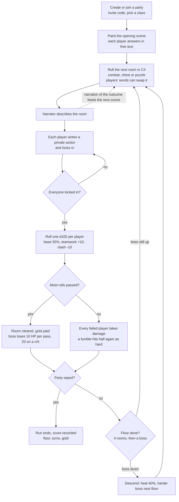
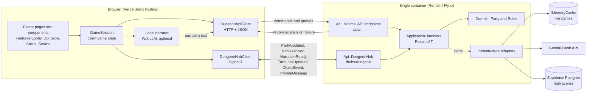

# DungeonForge

A cooperative, text-driven dungeon crawler for small parties. Players write what their hero does in free text; **C# decides what happens** (odds, damage, gold, rooms), and an AI narrator (Google Gemini Flash, or a model running in the player's browser) only describes it. Built with .NET 10, Blazor WebAssembly and SignalR, sized to run on free tiers.

## Architecture

Clean architecture: dependencies point inward, and a test (`LayeringTests`) fails the build if they don't.

| Project | Role | May reference |
|---|---|---|
| `src/DungeonForge.Domain` | Entities (`Party`, `PartyMember`), pure game rules (`Rules/`), `IRoller`. No framework code. | Shared |
| `src/DungeonForge.Application` | Use cases: one handler per feature returning `Result<T>`, plus the contracts, errors and ports (`IPartyStore`, `IPartyNotifier`, `IDungeonNarrator`, `IScoreBoard`) they need. No ASP.NET. | Domain |
| `src/DungeonForge.Infrastructure` | Adapters for those ports: Gemini narration, Supabase scores, `IMemoryCache` party store. | Application |
| `src/DungeonForge.Api` | Composition root and HTTP edge: Minimal API endpoints, SignalR hub, ProblemDetails mapping. | Application, Infrastructure |
| `src/DungeonForge.Web` | Blazor WebAssembly client. Talks to the Api over HTTP and SignalR only. | Shared |
| `src/DungeonForge.Shared` | Input limits both sides must agree on (`Limits`). | none |
| `tests/` | `DungeonForge.Tests` (xUnit, `WebApplicationFactory`), `DungeonForge.Web.Tests` (bUnit). | |

### Feature folders

A feature's files sit together, and the Api mirrors the Application path:

```
src/DungeonForge.Application/Features/Parties/UnlockTurn/
    Contracts.cs     request and response records (the DTOs)
    Handler.cs       the use case; Operation = "Command:UnlockTurn"
    Errors.cs        coded failures of this feature only
src/DungeonForge.Api/Features/Parties/UnlockTurn/
    UnlockTurnEndpoint.cs   route, validation filter, handler.ToHttp()
```

Feature groups: `Parties` (lobby, setup, the turn, chaos, vault, realtime ports), `Social` (whispers, peers, supervision), `Scores`, `Classes`, `Health`. The Web client follows the same idea under `Features/{Lobby,Dungeon,Social,Scores}`, with `Core/` for the API and hub clients and `Shared/` for types used by several features.

### Conventions that matter

- **Rules are pure.** Game math lives in static classes in `Domain/Rules/` taking `IRoller`; handlers call them, never inline math. RNG call order is fixed (tests script the roller).
- **State is ephemeral.** A party lives in `IMemoryCache` behind `IPartyStore` on a single instance; mutate it under `party.SyncRoot`. There are no per-turn database writes. Supabase holds high scores only.
- **Failures are values.** Handlers return `Result<T>`; an `Error` has a code, mapped to ProblemDetails by `.ToHttp(http)`. The catalog is generated into [docs/errors.md](docs/errors.md).
- **Zero build warnings**, files under ~250 lines, handlers registered in `Application/DependencyInjection.cs`.

More: [docs/map.md](docs/map.md) (where everything lives), [CLAUDE.md](CLAUDE.md) (working rules).

## The game loop



**How decisions change the game**

- **What you write sets your odds.** Action text is classified as attack, evade, loot or other. Teammates doing the same thing add 10% each, teammates working against you subtract 10% (capped at ±20, final chance 15 to 85%). Rolls under 5 are crits, 95 and over are fumbles.
- **Your words steer the dungeon.** Keywords in the opening scene and every action tally into a lean toward combat, treasure or mystery. It adds a capped chance (max 40%) that the next room is of that kind.
- **Your class matters.** Hit points differ per class, warriors and paladins draw attacks first, and each specialist sees secrets the others don't (mage: curses, bard: hidden coin, druid: trap truths).
- **Optional chaos mode.** Actions are blind, loot waits in a vault that players split or pocket, and spotters may catch a thief, which triggers a secret-ballot vote (forgive, demand a cut, banish, attack). A hidden traitor can backstab or steal life and wins by wiping the party before floor 5 or extracting alone with the Cursed Idol. The narrator also whispers mostly false claims to each player.
- **The social layer.** Players can whisper questions, accusations or offers to teammates, at a cost in tokens, and answer honestly or dodge.

Everything above that rolls or counts runs in `Domain/Rules/`; the narrator is never asked to decide an outcome.

## How the frontend and backend connect



- **Requests go over REST, updates come back over SignalR.** A player's action is a `POST` (`/api/parties/{id}/explore`); when the last player locks in, the server resolves the turn and pushes `TurnResolved` to the whole party. The slow narration arrives separately as `NarrationReady`, so the mechanics show up immediately.
- **Private data stays private.** Secrets, whispers and the traitor briefing use `SendPrivateAsync` to one connection only; public events carry no hidden information.
- **Narration has a fallback chain.** The browser's local model (if enabled), then Gemini Flash through a rotating key pool, then canned text. A narrator failure never fails a request.
- **The client mirrors the wire.** `Web/Features/*/Contracts.cs` hold the DTOs the Api returns, and both sides share `Shared/Limits.cs`. Errors arrive as ProblemDetails with a stable `code`.

## Run it

```bash
dotnet build            # zero warnings expected
dotnet test             # Api, domain and Web tests
dotnet run --project src/DungeonForge.Api    # http://localhost:5062
dotnet run --project src/DungeonForge.Web    # Blazor dev server
```

Configuration (all optional locally; without keys the narrator uses canned text and scores stay in memory):

| Setting | Purpose |
|---|---|
| `Narration:Enabled`, `GoogleFlash:ApiKey` (or `ApiKey_0..N`, `Gemini:ApiKeys[]`) | Gemini narration |
| `Narration:ClientNarration` | Let the player's browser write the narration |
| `Supabase:Url`, `Supabase:ServiceKey` | Persist high scores (schema in `Infrastructure/Scores/schema.sql`) |
| `Cors:AllowedOrigins` | Origins allowed to call the Api |
| `ApiBaseUrl` (`Web/wwwroot/appsettings.json`) | Where the client finds the Api |

## Deploy

- **Frontend:** pushing to `main` runs `.github/workflows/deploy-web.yml`, which publishes the Blazor app and deploys it to Vercel.
- **Backend:** the `Dockerfile` builds the Api image (`render.yaml` and `fly.toml` describe the free-tier hosts). Run a single instance, since live parties are held in memory.
